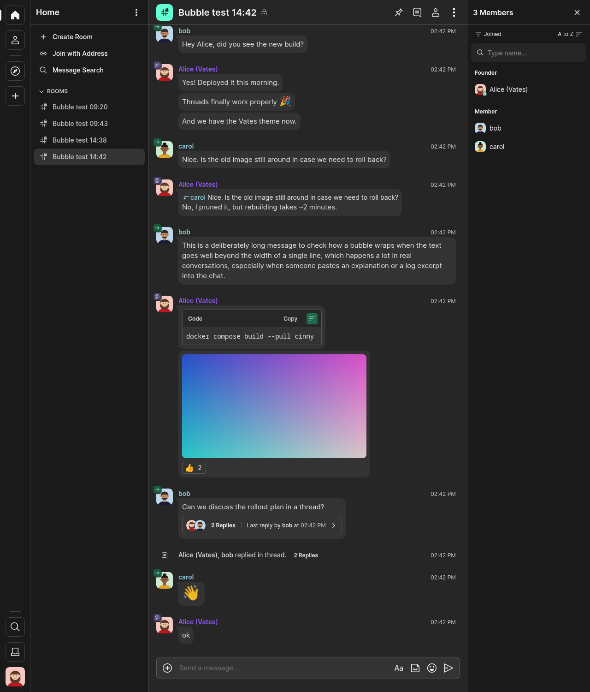
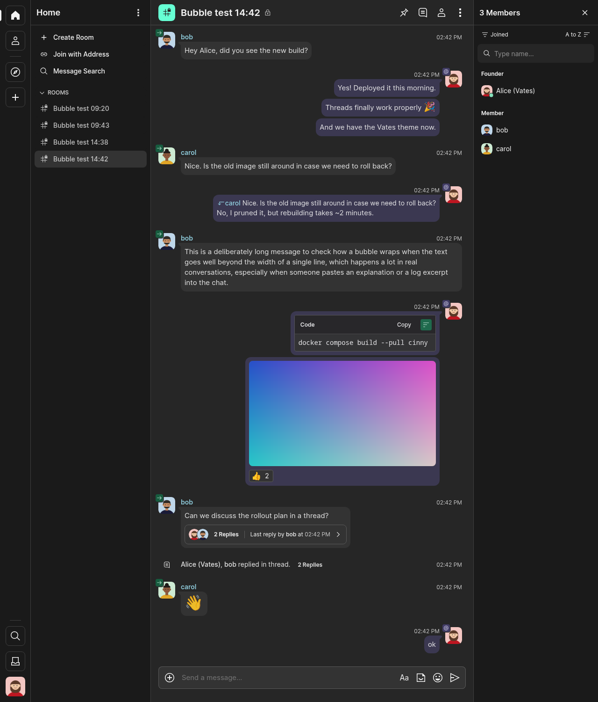
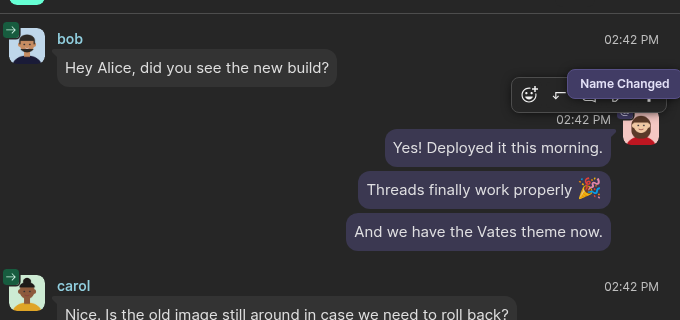
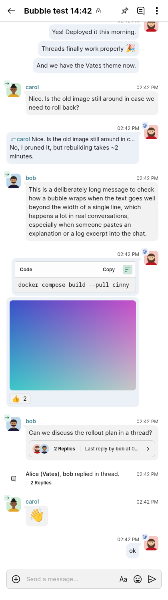
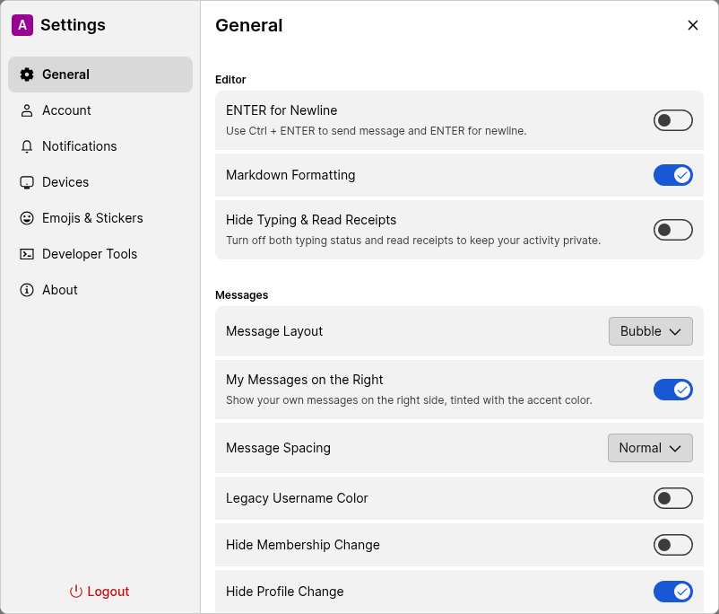

# cinny-themes

[](https://github.com/olivierlambert/cinny-themes/actions/workflows/upstream-check.yml)

Add-ons for [Cinny](https://github.com/cinnyapp/cinny), the Matrix client, built
on top of its `dev` branch (the nightly) as a Docker image:

- **17 extra colour themes**, including two for OLED screens;
- **own messages on the right** in the Bubble layout (WhatsApp-style), as an option.

This is the source of the Cinny build we run internally at [Vates](https://vates.tech),
published as required by Cinny's licence (AGPL-3.0). It is not affiliated with
the Cinny project.

## Themes

Added to **Settings → General → Appearance**:

| Light | Dark |
|---|---|
| Vates Light | Vates Dark, Vates OLED |
| | OLED Black |
| Catppuccin Latte | Catppuccin Frappé, Macchiato, Mocha |
| Gruvbox Light | Gruvbox Dark |
| Solarized Light | Solarized Dark |
| Rosé Pine Dawn | Rosé Pine |
| | Dracula, Nord, Tokyo Night |

With "System Theme" on, light themes are listed under *Light Theme* and dark
ones under *Dark Theme*.

- **OLED** themes use pure black for large areas (pixels off: battery, true
  contrast), near-black bubbles and off-white text. Trade-off: a field drawn in
  the content colour on a black panel (e.g. the member search) shows no box, only
  its icon and placeholder.
- **Vates** themes use the Vates colours: red `#BE1621` on warm white, navy
  `#1A1B38` with red `#E0424C` in dark mode, white text on red buttons.
- Three official colours were darkened slightly for readable contrast: Catppuccin
  Latte's yellow, Rosé Pine Dawn's gold and Solarized Light's body text.

## Own messages on the right

`patches/bubble-own-right.patch`: in the Bubble layout, your own messages are
shown on the right, tinted with the theme's accent, with only the time in the
group header. Your avatar moves to the right with them, so its membership badge
(Newly Joined, Name Changed, …) stays visible. Toggle: **Settings → General → Messages → My Messages on the Right**
(shown when the layout is Bubble; on by default). Pending messages and the thread
panel follow it; with the toggle off, or in the Modern/Compact layouts, nothing
changes. Upstream request: [cinnyapp/cinny#1978](https://github.com/cinnyapp/cinny/issues/1978).

| Before (Cinny `dev`) | After |
|---|---|
|  |  |

| Membership badge on your avatar | Mobile width |
|---|---|
|  |  |



The avatars in these screenshots are drawn test pictures, not real people.

## Build and run

```yaml
# docker-compose.yml, with this repo checked out as ./cinny-themes
  cinny:
    build:
      context: ./cinny-themes
      args:
        CINNY_REF: dev        # or a full commit SHA / release tag to pin
    image: cinny:dev-themes
    restart: unless-stopped
    volumes:
      - ./cinny/config.json:/app/config.json:ro
    ports:
      - "127.0.0.1:5433:80"
```

```bash
docker compose build --pull cinny && docker compose up -d cinny
```

Run it again to update to the latest nightly. The build needs about 4 GB of free
RAM. If upstream changed the code a patch relies on, **the build stops with an
error** instead of producing an image without the add-ons, and the running
container is left alone.

The [upstream check](.github/workflows/upstream-check.yml) does the same build
against Cinny's `dev` every day, so breakage shows up here before a rebuild.

## How it works

- `themes/extraThemesData.ts`: one small palette per theme (background, surface,
  text, accent, success/warning/critical, link). All of Cinny's ~60 colour tokens
  (hover, active, line, containers, text-on-colour) are derived from it.
- `themes/extraThemes.css.ts`: turns the palettes into CSS themes at build time.
- `patch-cinny.mjs`: adds the themes to the list in `src/app/hooks/useTheme.ts`;
  fails if that file no longer has the expected shape.
- `patches/*.patch`: other changes, applied after the themes with
  `patch --fuzz=0` (no guessing if upstream moved the code).

### Adding a theme

Append a palette to `themes/extraThemesData.ts` and check its contrast:

```bash
node check-themes.mjs      # Node >= 22.18
```

A palette can force the text colour on its filled buttons with `onColor` (see
Vates Dark); otherwise the most readable colour is picked.

## Provenance and licence

The code in this repository was written with an AI assistant (Claude) and
reviewed and tested by its maintainer. Cinny does not accept AI-generated code,
so none of it is meant to be submitted upstream as is.

AGPL-3.0, like Cinny: see [LICENSE](LICENSE). The patch modifies Cinny's own
source files, © Ajay Bura and the Cinny contributors.
